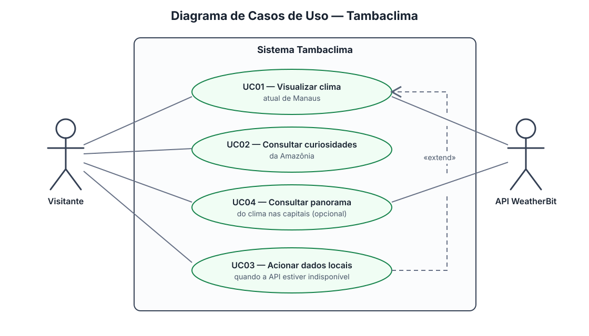

**ESPECIFICAÇÃO DE REQUISITOS DE SOFTWARE (ERS)**

|    Data    | Versão |                               Descrição                               |         Responsável         |
| :--------: | :-----: | :---------------------------------------------------------------------: | :--------------------------: |
| 31/08/2026 |   1.0   | Elaboração inicial da Especificação de Requisitos de Software (ERS) | Carlos Gabriel Silva Ribeiro |
| 10/11/2026 |   1.1   | Atualização de escopo, arquitetura, dados, API e casos de uso conforme repositório e GitHub Project | Carlos Gabriel Silva Ribeiro |
| 25/11/2026 |   1.2   | Revisão da arquitetura, integração, cache e fallback conforme implementação no repositório | Equipe Tambaclima |

**1\. Introdução**

A presente ERS descreve a arquitetura, os casos de uso, os requisitos de interface e as integrações de API do **Tambaclima**, comparados ao código do repositório em 25/11/2026. Este documento não certifica publicação, testes ou aceite formal.

O sistema consiste em uma *landing page* web construída em **HTML5, CSS3 e JavaScript puro (vanilla)**, sem dependência de frameworks complexos. Seu foco principal é a exibição de dados climáticos em tempo real para a cidade de Manaus-AM, apresentação de fatos/curiosidades climáticas da Amazônia e um panorama das capitais do Brasil.

**2\. Arquitetura Geral do Sistema**

**//***diagrama de pacote*

**2.1 Arquitetura de Camadas**

A arquitetura segue o padrão web em **camadas**. A estrutura atual contém HTML, CSS, JavaScript, JSON local e uma função serverless da Vercel:

1. **Camada de Apresentação (Interface / DOM):** Arquivo `index.html` e estilizações CSS3 (`style.css`), responsáveis por renderizar os cartões de clima, botões e seções de curiosidades.
2. **Camada de Lógica de Aplicação (JavaScript):** Scripts executados no navegador (`src/scripts/script.js`) que manipulam a DOM, capturam eventos do usuário e orquestram a exibição das informações.
3. **Camada de serviços e dados:** `src/scripts/script.js` consulta a Weatherbit diretamente em execução local quando há configuração ou chama `/api/weather` no deploy. Usa cache na `sessionStorage` e `src/data/mockedData.json` em caso de falha.
4. **Proxy de API no deploy:** `api/weather.mjs` valida método e capital, usa `WEATHERBIT_API_KEY` no servidor e consulta Current e Forecast Daily. Respostas bem-sucedidas são cacheadas na CDN por 300 segundos, com revalidação obsoleta por 600 segundos.

**3\. Modelo de Casos de Uso**

**3.1 Detalhados**

| ID  | ATOR               | DESCRIÇÃO                                                                                                |
| :-- | :----------------- | :--------------------------------------------------------------------------------------------------------- |
| A01 | Usuário/Visitante | Pessoa que acessa a *landing page* para consultar informações climáticas e curiosidades da Amazônia. |
| A02 | API Weatherbit     | Sistema externo provador dos dados meteorológicos brutos via JSON em tempo real.                          |

**3.2 Diagramas de Caso de Uso**

O visitante pode consultar o clima atual de Manaus, as curiosidades da Amazônia e, opcionalmente, o panorama do clima nas capitais. A API Weatherbit é o ator externo que fornece dados climáticos. O caso de uso de dados locais estende a consulta do clima quando a API está indisponível.

| ID   | Caso de Uso                               | Descrição                                                                                                                                                           |
| ---- | :---------------------------------------- | :-------------------------------------------------------------------------------------------------------------------------------------------------------------------- |
| UC01 | Visualizar o clima de Manaus              | O usuário acessa a página e visualiza automaticamente a temperatura, umidade, vento, índice UV e alertas climáticos atuais de Manaus.                             |
| UC02 | Consultar curiosidades da Amazônia       | O usuário navega pela seção dedicada a informações e curiosidades sobre o microclima e ecossistema amazônico.                                                   |
| UC03 | Adicionar Fallback (Modo offline / Mock)  | Quando a API falha, o sistema consome os dados locais (`src/data/mockedData.json`) e exibe uma notificação discreta ao usuário informando o uso de dados salvos. |
| UC04 | Consultar Panorama de Capitais (Opcional) | O usuário visualiza os dados meteorológicos resumidos de outras capitais brasileiras.                                                                               |

**3.3 Fluxos dos Casos de Uso**

**UC01 e UC02 (Visualizar Clima de Manaus / Dados educativos sobre Amazônia):**

* ***Ator Principal:*** Usuário (A01).
* ***Fluxo Principal:*** 1\. Usuário acessa o site; 2\. O script JavaScript dispara requisição à API Weatherbit; 3\. Dados são retornados e formatados na tela; 4\. Cartão principal de Manaus é atualizado.

**UC03 (Acionar Fallback):**

* ***Atores:*** Usuário (A01) e API Weatherbit (A02).
* ***Fluxo Exceção:***
  1. Requisição à API excede tempo limite ou retorna status HTTP \>= 400;
  2. O serviço de dados captura o erro;
  3. Arquivo de dados mockados é lido;
  4. Interface exibe aviso de "Dados em modo de contingência".

**4\. Modelo de Dados (lógico)**

O Tambaclima não tem banco de dados. No deploy, a função serverless `/api/weather` serve de proxy. O cliente mantém cache por aba em `sessionStorage` e usa `src/data/mockedData.json` como demonstração em falhas. `WeatherSnapshot` contém localidade, instante da observação, temperatura, sensação térmica, umidade, vento, pressão, UV, chance de chuva e descrição. Dados demonstrativos são identificados como não atuais.

**5\. Regras de Validação**

| Código | Regra                        | Ação do sistema                                                                                                                              |
| :------ | :--------------------------- | :--------------------------------------------------------------------------------------------------------------------------------------------- |
| RV-01   | Validação da resposta HTTP | Respostas não exitosas e erros de rede/timeout acionam fallback: cache da sessão correspondente, depois dados demonstrativos locais. |
| RV-02   | Formatação de temperatura  | Valores numéricos de temperatura devem ser arredondados para inteiros ou 1 casa decimal e acompanhados da unidade `°C`.                    |
| RV-03   | Limites do índice UV        | A interface classifica UV em baixo (≤2), moderado (≤5), alto (≤7), muito alto (≤10) e extremo (>10); alerta a partir de 6. |

**6\. Requisitos de Interface**

| ID    | Seção/Componente                              | Descrição da Interface e Funcionalidade                                                                                                                                                                                                                      |
| ----- | :---------------------------------------------- | :------------------------------------------------------------------------------------------------------------------------------------------------------------------------------------------------------------------------------------------------------------- |
| RI-01 | NavBar (Barra de Navegação)                   | Cabeçalho fixo ou superior contendo a marca/logo **Tambaclima** e links de navegação ancorados para rolagem rápida até cada seção da página (*Home*, *Amazônia*, *Detalhes*).                                                             |
| RI-02 | Hero Section (Clima Principal \- Manaus)        | Seção de impacto inicial destacando os dados essenciais e em tempo real de Manaus (cidade padrão): temperatura atual em destaque, ícone da condição do tempo, sensação térmica e resumo rápido.                                                      |
| RI-03 | Seção Amazônia                               | Painel visual e educativo dedicado a informações e curiosidades sobre a região amazônica (ex: rios voadores, umidade da floresta, regime de chuvas e importância ecológica).                                                                             |
| RI-04 | Seção de Clima Detalhado e Seletor de Cidades | Painel com métricas aprofundadas (umidade relativa, índice UV, velocidade do vento, pressão e chance de chuva) integrado a um **campo de busca/seleção de cidades**, permitindo alterar a localidade para consultar outras capitais ou municípios. |
| RI-05 | Layout Responsivo (Mobile-First)                | Adaptação fluida da ordem das 4 seções para dispositivos móveis, tablets e desktops utilizando CSS puro (Flexbox/Grid).                                                                                                                                   |

**7\. Requisitos de API REST**

* **Endpoints documentados:** GET `/current` e `/forecast/daily` da Weatherbit (contrato em `docs/api/openapi.yaml`). O primeiro fornece condições atuais; `pop` da previsão diária fornece a chance de chuva exibida.
* **Parâmetros da Requisição:**

  * **city:** Manaus
  * **country:** BR
  * **key:** variável secreta `WEATHERBIT_API_KEY`; nunca registrar valor real nos documentos ou no repositório.
  * **units:** sistema métrico padrão do provedor (parâmetro não enviado pelo código atual)
  * **lang:** pt
* **Tratamento de Erros de Integração:** O navegador aborta após 10 segundos; a função Vercel configura timeout de 8 segundos para as chamadas ao provedor. O fallback usa cache da sessão e depois dados estáticos de demonstração.

**8. Limites e pendências de escopo (25/11/2026)**

O repositório consulta Current e Forecast Daily: o painel mostra chance de precipitação para o primeiro dia, não uma série de previsão para vários dias. A interface implementa alertas UV/chuva, busca entre as 27 capitais e atualização manual. RF-02 (previsão detalhada para dias subsequentes) continua parcialmente atendido e precisa de decisão de escopo/rastreio na RTM. A implementação inclui função serverless no deploy, sem banco de dados ou autenticação. O estado de validação e aprovação formal deve ser confirmado na RTM e nos registros da equipe; commits recentes, por si só, não são evidência de aceite.
